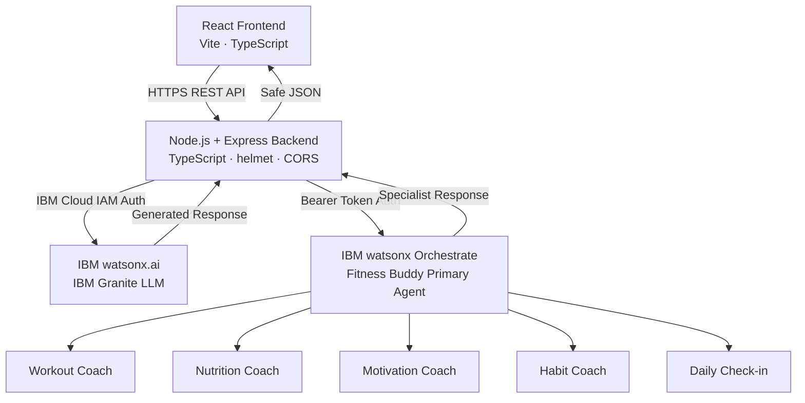

# 💪 Fitness Buddy — AI-Powered Fitness Companion

> Built with IBM watsonx.ai · IBM Granite · IBM watsonx Orchestrate

Fitness Buddy is a production-ready AI fitness companion that combines a modern React frontend with a Node.js/TypeScript backend to deliver personalized workouts, nutrition guidance, daily check-ins, and habit tracking — all powered by IBM AI services.

---

## Architecture



**The backend is the ONLY place that holds IBM credentials.**  
The React frontend never sees API keys, project IDs, or IAM tokens.

---

## Technology Stack

| Layer | Technology |
|---|---|
| Frontend | React 18, TypeScript, Vite, React Router v6 |
| Backend | Node.js, Express, TypeScript |
| AI (LLM) | IBM watsonx.ai + IBM Granite |
| AI (Agents) | IBM watsonx Orchestrate |
| Security | helmet, CORS, dotenv, input validation |
| Styling | Custom CSS design system (dark mode) |

---

## IBM Services Used

### IBM watsonx.ai + IBM Granite
- Used for direct LLM inference when Orchestrate is unavailable (fallback)
- Used for all `/api/workouts` and `/api/nutrition` requests
- Authenticated via IBM Cloud IAM (API key → bearer token)
- Model is configurable via `WATSONX_MODEL_ID`

### IBM watsonx Orchestrate (Phase 2 — Pre-existing)
- **Do not recreate these agents** — they already exist in your Orchestrate instance
- The backend calls the **Fitness Buddy Primary Agent** via REST API
- The primary agent routes requests to specialist agents:
  - **Workout Coach** — personalized workout plans
  - **Nutrition Coach** — meal planning and suggestions
  - **Motivation Coach** — encouragement and mindset guidance
  - **Habit Coach** — streak, consistency and habit advice
  - **Daily Check-in** — energy/soreness-based daily recommendation

---

## Project Structure

```
fitness-buddy/
├── frontend/
│   ├── src/
│   │   ├── components/     # Navbar, Sidebar, ChatMessage, ChatInput,
│   │   │                   # WorkoutCard, MealCard, ProgressCard,
│   │   │                   # StreakCard, CheckInCard, LoadingIndicator
│   │   ├── pages/          # Home, Chat, Workout, Nutrition, Progress, Profile
│   │   ├── services/       # api.ts — all backend API calls
│   │   ├── hooks/          # useFitnessBuddy.ts — chat state & logic
│   │   ├── types/          # Shared TypeScript types
│   │   ├── App.tsx
│   │   ├── main.tsx
│   │   └── index.css       # Full design system
│   ├── index.html
│   ├── package.json
│   ├── vite.config.ts
│   └── tsconfig.json
│
├── backend/
│   ├── src/
│   │   ├── config/         # env.ts — env validation at startup
│   │   ├── controllers/    # chatController, workoutController,
│   │   │                   # nutritionController, profileController,
│   │   │                   # progressController, checkInController
│   │   ├── services/       # watsonxService, orchestrateService,
│   │   │                   # chatService, profileService, progressService
│   │   ├── routes/         # One router per domain
│   │   ├── middleware/     # errorHandler.ts — centralized error handling
│   │   ├── types/          # Shared TypeScript types
│   │   ├── app.ts          # Express app with all middleware
│   │   └── server.ts       # Entry point — validates env then starts
│   ├── .env.example
│   ├── package.json
│   └── tsconfig.json
│
├── README.md
└── .gitignore
```

---

## Environment Variables

Copy `backend/.env.example` to `backend/.env` and fill in your values:

```env
# IBM watsonx.ai
WATSONX_API_KEY=your_ibm_cloud_api_key
WATSONX_PROJECT_ID=your_watsonx_project_id
WATSONX_URL=https://us-south.ml.cloud.ibm.com
WATSONX_MODEL_ID=ibm/granite-13b-chat-v2

# IBM watsonx Orchestrate (existing Phase 2 agents)
ORCHESTRATE_URL=https://api.us-south.watson-orchestrate.ibm.com
ORCHESTRATE_API_KEY=your_orchestrate_api_key
ORCHESTRATE_AGENT_ID=your_fitness_buddy_primary_agent_id

# Server
PORT=3000
FRONTEND_URL=http://localhost:5173
```

> **Never commit `.env` to Git.** It is already in `.gitignore`.

---

## How to Run Locally

### Prerequisites

- Node.js 18+
- npm 9+
- IBM Cloud account with watsonx.ai enabled
- IBM watsonx Orchestrate with the Fitness Buddy agents (Phase 2)

### 1. Clone and install

```bash
# Install backend dependencies
cd backend
npm install

# Install frontend dependencies
cd ../frontend
npm install
```

### 2. Configure environment

```bash
cd backend
cp .env.example .env
# Edit .env and fill in your IBM credentials
```

### 3. Start the backend

```bash
cd backend
npm run dev
# Backend runs at http://localhost:3000
# Health check: http://localhost:3000/health
```

### 4. Start the frontend

```bash
cd frontend
npm run dev
# Frontend runs at http://localhost:5173
```

---

## How to Build for Production

```bash
# Backend
cd backend
npm run build        # outputs to backend/dist/
npm start            # runs backend/dist/server.js

# Frontend
cd frontend
npm run build        # outputs to frontend/dist/
npm run preview      # preview production build locally
```

---

## API Reference

| Method | Endpoint | Description |
|---|---|---|
| GET | `/health` | Health check |
| POST | `/api/chat` | Chat with Fitness Buddy (Orchestrate → Granite fallback) |
| POST | `/api/workouts` | Generate a workout plan |
| POST | `/api/nutrition` | Generate a meal plan |
| POST | `/api/checkin` | Daily check-in and recommendation |
| GET | `/api/progress` | Get progress data |
| POST | `/api/progress/complete-workout` | Mark a workout complete |
| GET | `/api/profile` | Get user profile |
| POST | `/api/profile` | Create user profile |
| PUT | `/api/profile/:userId` | Update user profile |

### Chat Request

```json
POST /api/chat
{
  "message": "Create today's workout",
  "userContext": {
    "goal": "weight_management",
    "fitnessLevel": "beginner",
    "durationMinutes": 30,
    "equipment": "none",
    "location": "home",
    "diet": "vegetarian"
  },
  "conversationHistory": []
}
```

### Chat Response

```json
{
  "success": true,
  "message": "Here is your workout for today...",
  "source": "orchestrate",
  "specialist": "workout"
}
```

---

## How IBM Granite Is Called

1. The backend validates `WATSONX_API_KEY`, `WATSONX_PROJECT_ID`, `WATSONX_URL`, `WATSONX_MODEL_ID` at startup.
2. [`watsonxService.ts`](backend/src/services/watsonxService.ts) exchanges the API key for an IBM Cloud IAM bearer token (cached, refreshed 5 min before expiry).
3. It builds a prompt using the Fitness Buddy system behavior + user context + conversation history.
4. It calls `POST {WATSONX_URL}/ml/v1/text/generation?version=2023-05-29` with the Granite model.
5. The generated text is returned to the controller, then sent to the frontend.
6. **Credentials never leave the backend.**

To configure a different Granite model, change `WATSONX_MODEL_ID` in `.env`.  
Available Granite models (check your IBM Cloud region):
- `ibm/granite-13b-chat-v2`
- `ibm/granite-20b-code-instruct-v2`
- `ibm/granite-3-8b-instruct`

---

## How IBM watsonx Orchestrate Is Called

1. The backend reads `ORCHESTRATE_URL`, `ORCHESTRATE_API_KEY`, `ORCHESTRATE_AGENT_ID` from `.env`.
2. [`orchestrateService.ts`](backend/src/services/orchestrateService.ts) calls:
   ```
   POST {ORCHESTRATE_URL}/v1/agents/{ORCHESTRATE_AGENT_ID}/chat
   Authorization: Bearer {ORCHESTRATE_API_KEY}
   ```
3. The existing **Fitness Buddy Primary Agent** (Phase 2) receives the request and routes it to the appropriate specialist.
4. The response is returned through the backend to the frontend.
5. If Orchestrate is unavailable or not configured, the backend falls back to a direct Granite call and logs the fallback (no credentials are exposed).

### Finding your Orchestrate Agent ID

1. Open IBM watsonx Orchestrate
2. Go to **Agents** in the left sidebar
3. Click on **Fitness Buddy - Primary Agent**
4. Copy the **Agent ID** from the details/settings panel
5. Set it as `ORCHESTRATE_AGENT_ID` in `backend/.env`

---

## How to Test the API

### Using curl

```bash
# Health check
curl http://localhost:3000/health

# Get demo profile
curl "http://localhost:3000/api/profile?userId=demo"

# Get progress
curl "http://localhost:3000/api/progress?userId=demo"

# Chat
curl -X POST http://localhost:3000/api/chat \
  -H "Content-Type: application/json" \
  -d '{
    "message": "Create a 30-minute beginner home workout",
    "userContext": {
      "goal": "general_fitness",
      "fitnessLevel": "beginner",
      "durationMinutes": 30,
      "equipment": "none",
      "location": "home"
    }
  }'

# Daily check-in
curl -X POST http://localhost:3000/api/checkin \
  -H "Content-Type: application/json" \
  -d '{"energyLevel":"medium","sorenessLevel":"not_sore","availableMinutes":30}'

# Complete a workout
curl -X POST http://localhost:3000/api/progress/complete-workout \
  -H "Content-Type: application/json" \
  -d '{
    "userId": "demo",
    "title": "Morning HIIT",
    "durationMinutes": 30,
    "feedback": "perfect"
  }'
```

### Running automated tests

```bash
cd backend
npm test
```

---

## Security Considerations

- **All IBM credentials are server-side only** — never exposed to the React frontend
- IAM tokens are cached in-memory and refreshed automatically
- Helmet.js sets secure HTTP headers
- CORS is restricted to `FRONTEND_URL`
- Request bodies are limited to 50kb
- Input is validated before reaching AI services
- Error messages are sanitized — raw IBM API errors never reach clients
- `.env` is in `.gitignore` — never committed

---

## Demo Data

A demo profile is pre-loaded for development:

| Field | Value |
|---|---|
| ID | `demo` |
| Name | Demo User |
| Goal | Weight Management |
| Level | Beginner |
| Duration | 30 minutes |
| Equipment | None |
| Location | Home |
| Diet | Vegetarian |

Access it at `GET /api/profile?userId=demo`.

---

## Hackathon Demo Flow

1. Open **Home** — show the dashboard with streak and quick actions
2. Open **Profile** — show the configuration form
3. Open **Chat** — send "Create today's workout" and show IBM Granite/Orchestrate response
4. Open **Workout** — generate a workout, show the exercise cards
5. Complete the workout with feedback ("Perfect") — show streak increment
6. Open **Daily Check-in** — submit energy/soreness, show AI recommendation
7. Open **Nutrition** — generate a full day meal plan
8. Open **Progress** — show streak, total workouts, completion rate

---

## Future Improvements

- [ ] User authentication (JWT / IBM App ID)
- [ ] PostgreSQL / MongoDB data persistence
- [ ] Wearable device integration (Apple Health, Google Fit)
- [ ] Push notifications for workout reminders
- [ ] Image recognition for food logging
- [ ] Voice input for chat
- [ ] Progressive Web App (PWA) for mobile installation
- [ ] Multi-language support

---

## Phase 2 — Existing Orchestrate Agents

These agents already exist in IBM watsonx Orchestrate and **must not be deleted or recreated**:

1. **Fitness Buddy - Primary Agent** — Main routing agent
2. **Fitness Buddy - Workout Coach** — Personalized workout planning
3. **Fitness Buddy - Nutrition Coach** — Meal planning and dietary guidance
4. **Fitness Buddy - Habit Coach** — Streak and consistency coaching
5. **Fitness Buddy - Daily Check-in** — Energy and soreness-based recommendations

The backend integrates with the Primary Agent via REST API. The Primary Agent routes internally to specialists.
